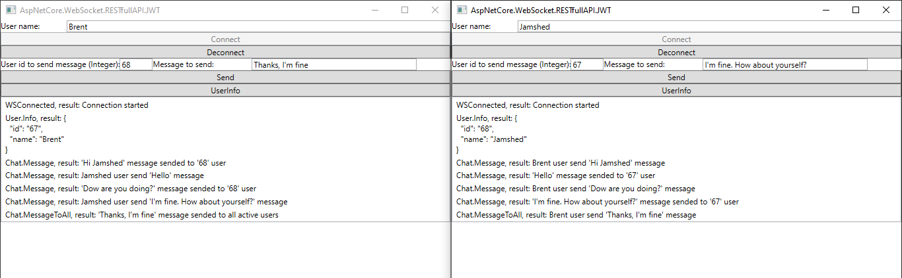

# AspNetCore.WebSocket.RESTfulAPI 

AspNetCore.WebSocket.RESTfulAPI is a WebSocket communication library for ASP.NET Core applications. It exposes controller methods as lightweight REST-style WebSocket operations for real-time applications such as chat and games. The current projects target .NET 10.


## List of NuGet packages
[](https://www.nuget.org/packages/AspNetCore.WebSocket.RESTfulAPI)
[](https://www.nuget.org/packages/AspNetCore.WebSocket.RESTfulAPI)

[](https://www.nuget.org/packages/AspNetCore.WebSocket.RESTfulAPI.JWT)
[](https://www.nuget.org/packages/AspNetCore.WebSocket.RESTfulAPI.JWT)
           
<table>
   <thead>
    <th>№</th>
    <th>Name</th>
    <th>Description</th>
    <th>Endpoints</th>
  </thead>
  <tbody>
    <tr>
        <td align="center">1.</td>
        <td> <a href="https://www.nuget.org/packages/AspNetCore.WebSocket.RESTfulAPI">AspNetCore.WebSocket.RESTfulAPI</a></td>
        <td>This for implementing and using Web Socket on ASP.Net Core to create real-time communication app for building chat, game or other.</td>
        <td> <a href="https://app.swaggerhub.com/apis-docs/mirolimjon/AspNetCore.WebSocket.RESTfulAPI/1.0.0">View</a> </td>
    </tr>
    <tr>
        <td align="center">2.</td>
        <td> <a href="https://www.nuget.org/packages/AspNetCore.WebSocket.RESTfulAPI.JWT/">AspNetCore.WebSocket.RESTfulAPI.JWT</a></td>
        <td>This library also for creating real-time communication app like AspNetCore.WebSocket.RESTfulAPI, but it is customized for using authorized user by JSON Web Token (JWT)</td>
        <td> <a href="https://app.swaggerhub.com/apis-docs/mirolimjon/AspNetCore.WebSocket.RESTfulAPI/1.0.0">View</a> </td>
    </tr>
  </tbody>  
</table>


## Getting Started
### Setting up the server

Make sure WebSockets are enabled in your hosting environment (for example, [WebSockets for IIS](https://learn.microsoft.com/iis/configuration/system.webserver/websocket)). Install version 2.0.12 and register the services:

```powershell
Install-Package AspNetCore.WebSocket.RESTfulAPI
```
```
services.AddWebSocketServices();
```
Map the middleware in the HTTP pipeline:
```
app.WebSocketRESTfulAPI("/WSMessenger");
```
Configuration parameters are optional: `path` is the WebSocket endpoint (for example, clients connect to `ws://{BaseSiteURL}/WSMessenger`), `receiveBufferSize` controls the protocol buffer (default 4 KB), `keepAliveInterval` controls ping/pong keep-alives (default 60 seconds), and `logAllWebSocketRequestAndResponse` enables full payload logging (default `false`). Keep payload logging disabled in production because request and response data may contain sensitive information.

All configuration is done. Now, you are able to create your own Web Socket controllers with APIs.<br/> 

Create a controller in a `Hubs` folder (or another assembly discovered by the middleware).

Example code:
```
public class ChatController
{
    private readonly WebSocketHub _socketHub;
    private readonly WsUserInfo _wsUserInfo;

    public ChatController(WebSocketHub socketHub, WsUserInfo wsUserInfo)
    {
        _socketHub = socketHub;
        _wsUserInfo = wsUserInfo;
    }

    //Your APIs  
}
```
WebSocket controllers must end in `Controller` and have exactly one public constructor with exactly these two parameters: `WebSocketHub` (or the registered derived hub) and `WsUserInfo` (or a compatible derived user-info type). Do not inject services into the controller constructor. This restriction allows controller factories and endpoint metadata to be prepared once during startup.

Services such as repositories and `ILogger<T>` must be endpoint parameters marked with `[FromServices]`. A new DI scope is created for every WebSocket request, and those services are resolved from that request scope.

Example to create API:
```
[WsHubMethodName("Chat.Message")]
public async Task<ResponseModel> MessageWithFriend(
    Guid userId,
    string message,
    [FromServices] ILogger<ChatController> logger)
{
    logger.LogInformation("Sending a chat message.");
    await _socketHub.SendNotificationAsync(userId, $"{_wsUserInfo.Name} user send '{message}' message", "Chat.Message");
    return await ResponseModel.SuccessRequestAsync($"'{message}' message sent to '{userId}' user");
}
```

`WsHubMethodName` must contain exactly one dot in the form `Controller.Method`; malformed names are rejected. Endpoint methods must return `Task<ResponseModel>`. Parameters supplied by the client are converted and validated before invocation; optional parameters may define defaults. Parameters marked `[FromServices]` are never read from the client payload. `SendNotificationAsync` can target a user ID, a collection of user IDs, or a WebSocket connection.

Endpoint metadata, controller factories, parameter bindings, and invokers are cached during startup, so requests do not repeatedly scan controllers or reflect over methods.

### WebSocket request and response format

Send a JSON object as a binary WebSocket message. The middleware treats non-binary messages as a disconnect:

```json
{
  "id": "request-123",
  "method": "Chat.Message",
  "params": {
    "userId": "00000000-0000-0000-0000-000000000000",
    "message": "Hello"
  }
}
```

The response contains the request `id`, method name, and either `result` or a client-safe error. Server exception details, connection strings, file paths, and other sensitive data are not returned to clients.

The library uses these WebSocket error codes:

| Code | Meaning |
| --- | --- |
| 101 | Invalid JSON request body |
| 102 | Missing or empty request `id` or `method` |
| 103 | Invalid method format; expected `Controller.Method` |
| 104 | Controller discovery failed during endpoint initialization |
| 105 | Connection is not registered or is no longer authenticated |
| 106 | Missing or invalid endpoint parameters |
| 107 | Requested method was not found |
| 108 | Controller activation failed |
| 109 | Invalid endpoint configuration |
| 110 | Internal method execution failure; the client receives a sanitized message |

### Set up the client

Use any WebSocket client. During the handshake, the default middleware expects `UserName` (a non-empty string) and `UserId` (a unique GUID) headers. The JWT package provides the corresponding JWT-authenticated middleware and hub extension; its connection/authentication rules should be followed instead of sending untrusted identity headers.

### JWT-authenticated WebSockets

Install `AspNetCore.WebSocket.RESTfulAPI.JWT` when the WebSocket identity must come from a JWT instead of `UserName` and `UserId` handshake headers. Its current package uses `AspNetCore.WebSocket.RESTfulAPI` 2.0.12. Register authentication and WebSocket services, then map the JWT middleware:

```csharp
services.AddAuthentications();
services.AddWebSocketServices();

app.WebSocketRESTfulApiJwt("/WSMessenger");
```

The JWT middleware reads the authenticated principal's `UserId` claim as a GUID and its name claim as the user name. Invalid, expired, missing, or incomplete authentication is rejected during connection setup.


## Result
You can find example for both NuGets from [Test folder](https://github.com/MirolimMajidov/WebSocket.RESTfulAPI/tree/master/tests)<br/>
<center></center>

## Override
See example from [AspNetCore.WebSocket.RESTfulAPI.JWT](https://github.com/MirolimMajidov/WebSocket.RESTfulAPI/tree/master/src/AspNetCore.WebSocket.RESTfulAPI.JWT) project to override AspNetCore.WebSocket.RESTfulAPI's some classes and methods and events like `OnConnectedAsync`, `OnDisconnectedAsync` and other.

## Support
Did you like this NuGet package? If it's helpful for you, supporting by buying me a coffee.

<a href="https://www.buymeacoffee.com/MirolimMajidov" target="_blank" style="max-width: 170px;"></a>
